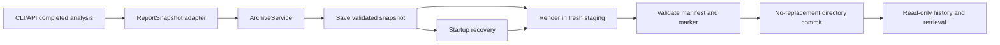

# Architecture Blueprint — Report Archiving and Recovery

## 1. Scope and drivers

This document covers FR-03 (report archiving and retrieval), QR-02 (recoverability), and INV-03 through INV-06. It adds an archive around completed report output from the baseline on main. Source revision is recorded in docs/req/requirements.yaml. The primary drivers are independent run identity, section isolation, truthful completion, deterministic recovery and local-file compatibility.

The archive does not evaluate investment recommendations, alter model reasoning, change trading-memory deduplication, or redesign graph checkpoints. It preserves the result supplied by the completed analysis. Its integrity checks establish archive completeness, not the financial correctness of a report.

## 2. Boundaries and authority

Analysis produces final report fields. A deterministic adapter extracts only allowed fields into an immutable ReportSnapshot. ArchiveService owns snapshot validation, commit and recovery; ReportRenderer writes only to a fresh private staging directory. QueryService reads verified committed archives. Report prose cannot choose paths, execute commands, modify metadata, or mark a run committed.

Trading memory and existing state logs remain separate outputs. Their success is not a prerequisite for an archive commit. Archive recovery does not invoke record_decision, memory storage, settlement, reflection or the analysis graph. This permits multiple same-ticker/date report archives without modifying the legacy memory policy.



## 3. Components and target modules

| Component | Target module | Responsibility |
|---|---|---|
| ArchiveService | `TradingAgents/tradingagents/archive/service.py` | Archive lifecycle, bounded retries and startup recovery |
| FileArchiveStore | `TradingAgents/tradingagents/archive/storage.py` | OS-backed root lock, snapshots, fresh staging, no-replacement publication and cleanup |
| ArchiveContracts | `TradingAgents/tradingagents/archive/models.py` | Field allowlists, UUIDs, versions, manifests and typed results |
| QueryService | `TradingAgents/tradingagents/archive/query.py` | Historical filters and integrity-checked retrieval |
| ReportRenderer | `TradingAgents/tradingagents/reporting.py` | Reuse fixed report section mapping; render from saved content/timestamp |
| Analysis adapter | `TradingAgents/tradingagents/graph/trading_graph.py`, `TradingAgents/cli/run.py` | Create per-analysis archive context and invoke the service after final result collection |
| History CLI | `TradingAgents/cli/archive.py` | Standalone history/recovery entry without importing model clients |

These are proposed module locations; new archive modules are not present in the baseline. Archive modules depend on contracts, storage and rendering primitives, not on graph execution, model clients or trading-memory services.

## 4. Analysis entry and public contracts

At the common create_run_state entry, open the archive service and perform recovery, then reserve a fresh UUIDv4 for the new analysis context. One graph instance has at most one active analysis context; concurrent analyses use separate graph/service instances. A failed ID reservation can choose another ID before analysis starts. Once a snapshot is saved, retries retain its identity.

Both CLI and programmatic execution call record_decision after obtaining final_state. Add the automatic archive invocation at the beginning of that completion path, before the legacy state/memory writes. Archive errors return a separate archive result and do not cause a second analysis. The adapter passes the already-reserved context and an allowlisted report payload. Repeated completion for the same context does not allocate another ID.

The CLI's live section callback continues updating its in-memory display but stops writing report sections into the shared legacy ticker/date report directory. Completed report files are written through the canonical archive protocol. This prevents a new analysis from overwriting old report sections before the archive step. Existing state/message logs are separate from report archives; no legacy report migration is performed.

| Interface | Contract |
|---|---|
| `ArchiveService.open(config)` | Resolve root, recover pending snapshots, return service plus per-run startup diagnostics |
| `archive(snapshot)` | Accept an immutable validated ReportSnapshot and return ArchiveResult; never receive an unrestricted configuration object |
| `recover_pending()` | Reconstruct only saved pending snapshots with their original IDs |
| `list_runs(ticker=None, analysis_date=None)` | Return valid committed summaries; exact normalized ticker/date filters, combined by intersection |
| `get_run(run_id)` | Return verified complete Markdown report, metadata and section manifest, or typed error |
| `export_run(run_id, destination)` | Copy verified content to a separately reserved empty destination; refuse existing non-empty or overlapping canonical destinations |

ArchiveResult contains run_id, status, safe error code, retryability, report path and warnings. A successful report path is present only for a valid COMMITTED archive. The Python `propagate` result remains `(final_state, signal)`; `last_archive_result` and a structured warning expose archive outcome. The CLI displays analysis completion and archive status separately.

History list/get opens QueryService in read-only mode and does not trigger recovery or construct an analysis graph. The explicit history recover operation and analysis-service startup use ArchiveService. Thus read-only retrieval has no hidden write side effects.

The existing save_reports signature and Path return type remain for optional extra exports. When it refers to the current completed analysis it exports the already committed archive, without generating another identity. A direct save_reports call with external final_state is treated as an explicit new archive request with a fresh context; it must first complete the same canonical archive protocol before optional export. Non-empty export destinations fail with EXPORT_CONFLICT.

Independent history commands are `python -m cli.archive list`, `python -m cli.archive get <run_id>` and `python -m cli.archive recover`. Filters are `--ticker` and `--analysis-date`; root override is `--archive-dir`. Exit codes: 0 success/empty list, 2 invalid argument, 3 unknown run, 4 storage/recovery/integrity failure. These commands are design targets, not currently installed commands. Existing analysis command parsing remains intact.

## 5. Snapshot and rendering contract

The snapshot envelope contains schema_version, renderer_version, run_id, snapshot_hash, ticker, analysis_date, created_at and payload. Creation time is UTC and fixed for reconstruction. analysis_date maps explicitly to final_state.trade_date. Metadata is allowlisted: asset type, selected analysts, provider/model identifiers and output language may be stored when available; unknown optional values remain null. Complete configuration, environment, endpoints with credentials and raw model message history are excluded.

Canonical snapshot JSON is UTF-8 with sorted keys, compact separators and no NaN/Infinity. snapshot_hash is SHA-256 over the envelope without its own hash field. Text is not Unicode-normalized. An immutable saved snapshot is not re-sanitized into a different hash during recovery. If a credential is detected, block persistence before saving the snapshot and return a safe diagnostic. This boundary check is deterministic and makes no model request.

| Section path | Baseline final-state field |
|---|---|
| `1_analysts/market.md` | market_report |
| `1_analysts/sentiment.md` | sentiment_report |
| `1_analysts/news.md` | news_report |
| `1_analysts/fundamentals.md` | fundamentals_report |
| `2_research/bull.md` | investment_debate_state.bull_history |
| `2_research/bear.md` | investment_debate_state.bear_history |
| `2_research/manager.md` | investment_plan |
| `3_trading/trader.md` | trader_investment_plan |
| `4_risk/aggressive.md` | risk_debate_state.aggressive_history |
| `4_risk/conservative.md` | risk_debate_state.conservative_history |
| `4_risk/neutral.md` | risk_debate_state.neutral_history |
| `5_portfolio/decision.md` | final_trade_decision |

This map matches reporting._SECTIONS in the inspected main revision. Empty optional sections are omitted from files and manifest. A complete archive includes complete_report.md and every applicable non-empty section; configured HTML is an additional required artifact when enabled. The renderer's header uses the saved creation timestamp, not the current clock. Format/mapping changes require a renderer version change; unsupported versions are preserved and rejected rather than guessed.

## 6. Storage and completion protocol

Resolve root once: explicit archive_dir, then TRADINGAGENTS_ARCHIVE_DIR, then `<results_dir>/archive`. CLI and API share the same resolver. The supported recovery environment is local NTFS on one Windows host, outside network shares or synchronized directories.

```text
<archive_root>/
  archive.lock
  pending/<run_id>/intent.json
  pending/<run_id>/snapshot.json
  pending/<run_id>/failure.json
  staging/<run_id>.<attempt_id>/...
  runs/<run_id>/complete_report.md
  runs/<run_id>/<fixed-section-paths>
  runs/<run_id>/manifest.json
  runs/<run_id>/commit.json
  quarantine/<incident_id>/...
```

1. Acquire the archive-root OS lock, validate UUID/root/version, and check for a committed destination. An identical valid snapshot hash returns the existing result; a different hash returns RUN_ID_CONFLICT.
2. Reserve the pending directory, write safe intent metadata, then write/flush/close a temporary snapshot in that directory. Publish snapshot.json and read-back validate its hash. This confirmation starts the process-interruption recovery guarantee.
3. Render all outputs in a fresh staging attempt using only the validated saved snapshot and renderer version. Never reuse a report directory from an earlier run.
4. Write manifest.json with version, run identity, snapshot hash, section identifiers, fixed relative paths, UTF-8 byte sizes and SHA-256 digests for every report artifact. It does not list itself or commit.json.
5. Validate section completeness and bytes, then write commit.json containing run_id, snapshot_hash and SHA-256 of the exact manifest bytes. A marker in staging is not a successful archive.
6. Close handles and atomically rename staging on the same volume into a previously absent runs/<run_id>. Never replace an existing final directory. Readers recognize completion only in this final path after all checks pass.
7. Verify through get_run and mark the result COMMITTED. Attempt cleanup of that run's pending/abandoned staging data before returning the result. Cleanup failure adds a warning and does not reverse commit.

The manifest lists complete_report.md, configured complete_report.html and all declared sections. SHA-256 detects accidental inconsistency; it is not authentication against an attacker who can rewrite the entire archive. Power-loss durability is outside the process-interruption guarantee.

## 7. State and recovery

| State | Evidence | Query behavior | Recovery action |
|---|---|---|---|
| RECEIVED | Trusted intent; no confirmed complete snapshot | NOT_READY | Missing input after interruption is a reported failure |
| SNAPSHOT_READY | Valid confirmed snapshot | NOT_READY | Render a fresh staging attempt |
| STAGING | Valid snapshot and incomplete output attempt | NOT_READY | Discard only the abandoned attempt and rebuild from snapshot |
| COMMITTED | Final directory, marker, manifest and files validate | Complete report available | Retain archive and clean residual temporary data |
| RETRY_PENDING | Valid snapshot but storage/lock fault prevents commit | NOT_READY | Preserve snapshot and retry at a later startup |
| FAILED | Missing/corrupt/unsupported snapshot or conflicting destination | Typed failure | Preserve identifiable diagnostic; isolate unsafe fragments |

open performs a recovery pass under the root lock. A valid committed directory matching residual pending identity wins and is reused. Otherwise a valid snapshot is rendered and committed. Missing/corrupt input produces an identifiable error where intent is trustworthy; fragments without a trustworthy identity go to quarantine without fabricating a run. Unknown versions remain intact. A corrupt committed directory is not overwritten or automatically repaired.

Recovery never invokes graph execution, data tools, model clients, memory writes, settlement or reflection. Graph checkpoints remain a different analysis-time mechanism. The guarantee does not cover completed model output that was never saved in a complete snapshot.

## 8. Concurrency, permissions and failure policy

All writers share an OS-backed exclusive archive-root lock. Process exit releases OS ownership; the continued existence of archive.lock does not mean it is held. Wait at most five seconds, then return LOCK_BUSY. Publication allows the initial attempt plus two transient I/O retries with 50 ms and 100 ms backoff. Do not retry validation/conflict/version errors. Keep a valid snapshot after retries are exhausted. A later open provides a new bounded recovery opportunity.

Queries inspect final directories only and validate before success. Invalid run IDs, absolute paths, parent traversal, Windows alternate data streams and symlink/junction escapes are rejected. Fixed filenames and manifest validation bound all archive access. Additional export reserves its destination and refuses canonical-root overlap or existing content. Report text is never interpreted as a path or command.

Role/file permissions are in docs/architecture/permission-model.md; failure actions are in runtime-policy-catalog.md. Operational errors use safe codes, run IDs, timestamps and retryability, never raw configuration or sensitive report text.

## 9. Verification, observability and change policy

The trace matrix maps every fit criterion to tests and monitors. QR-02 uses 30 reset trials with 100 committed and 10 pending runs; snapshot size is at most 1 MiB each. Time immediately before recover_pending through normal retrieval of all ten, including lock/scans/rendering/publication/validation/cleanup attempts. Exclude Python startup, user restart wait and unresolved external-fault wait; fixture reset is outside timing. Record all durations, errors, host OS/CPU/RAM/storage, runtime/commit, renderer settings and fixture digest. The 29th sorted duration must be <=2 seconds and every trial must be correct. Larger snapshots are supported without silently truncating them; this timing target does not cover them.

Monitor committed/pending counts, retry counts, run-ID conflicts, manifest mismatches, recovery duration and forbidden recovery calls. Logs do not reproduce credentials or report bodies. Existing legacy reports are not migrated or indexed. Successful archives are retained without automatic pruning; only run-owned temporary artifacts are cleaned.

Changes to report fields, identity, versions, hash format, root resolution or commit order require corresponding updates to D1 criteria, ADR, invariants, trace entries and test fixtures. Reconsider file scanning or lock granularity on measured scale/latency pressure. Design parameters and test specifications are not measured implementation results.

## 10. Artifact index

- [Requirements](docs/req/requirements.yaml)
- [Architecture decision](docs/architecture/adr/001-report-archive.md)
- [Invariant register](docs/architecture/invariants.md)
- [Trace matrix](docs/architecture/trace-matrix.md)
- [Memory and state](docs/architecture/memory-design.md)
- [Permission model](docs/architecture/permission-model.md)
- [Runtime policies](docs/architecture/runtime-policy-catalog.md)
- [Candidate evaluation](docs/architecture/evaluation-table.md)
